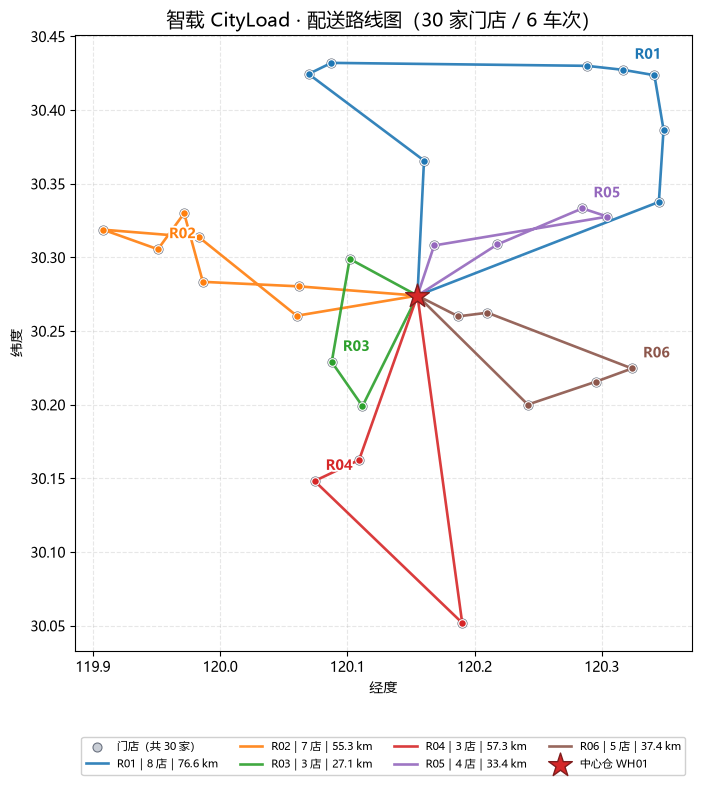
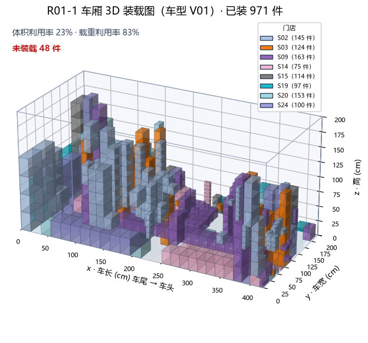
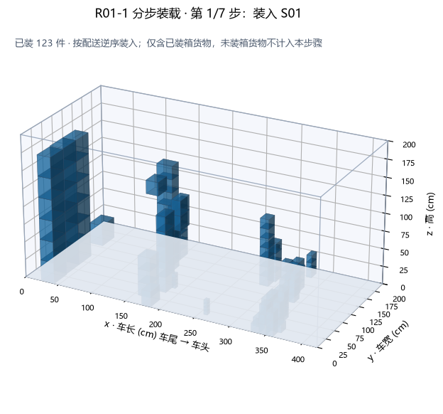

# CityLoad — Multi-Constraint Urban Delivery Intelligent Loading & Dispatch System

> **AI Reshapes Industry · Architect Challenge · TRACK 02 AI＋Logistics · "Urban Delivery Intelligent Loading"**
>
> GitHub repository: https://github.com/YYZfanliuo/cityload-intelligent-loading (private)
>
> 中文版见 [README.md](README.md)

---

## Reviewer Quick Verification (3 steps, ~3 minutes)

1. **Install dependencies** (Python 3.10+): `pip install -r requirements.txt`
2. **Run the pipeline**: `python run.py --data data/ --out outputs/verify/` (completes in ~2 seconds)
3. **View results**: open `outputs/verify/report.html` in a browser

- This project runs **fully without any API key** (all core features and tests are key-independent);
- To test LLM-enhanced features (natural-language order parsing, etc.), use **your own API key** — enter it directly in the interactive UI sidebar (kept in memory only, never written to disk) or configure via environment variables; see "6. How to Run".

---

## 1. Team

- **Team name**: Deepsleep
- **Team lead**: Yan Yizhuo (闫燚卓) — Project development coordination
- **Members**: Zhang Xian (张弦) — Algorithm planning & security testing; Chen Jiaxuan (陈嘉轩) — Development support

> Built by the team with AI coding tools: team members made the architectural decisions, algorithm design, quality acceptance and compliance; AI assistants contributed to code implementation and testing. All code and experimental evidence are included in this repository.

## 2. Business Scenario

A faithful replication of the challenge's real-world scenario: **central warehouse → 30 chain pharmacies urban delivery**. Each day the warehouse delivers hundreds of SKUs to multiple stores while satisfying:

- **Vehicle capacity** — both weight and cargo-space constraints;
- **Loading conditions** — fragile goods (no stacking on top), non-stackable items, stack-height limits, compartment geometry;
- **Delivery time windows** — 08:00–12:00 / 12:00–16:00 / 14:00–18:00;
- **Execution order** — loading sequence must coordinate with store delivery order to avoid rehandling (unloading blocked cargo).

In current industry practice these steps rely heavily on manual experience, making integrated optimization under multiple constraints difficult. This system links **fleet matching & route optimization, 3D loading planning, and loading/unloading guidance** into one runnable pipeline, with quantified comparison against a manual-experience-style baseline (greedy strategy).

## 3. Core Approach

**Three algorithm modules + one automated pipeline:**

1. **Fleet Matching & Route Optimization** (`solver/routing.py`)
   OR-Tools CVRPTW model: weight capacity, time windows, per-vehicle working-hour limits, heterogeneous vehicle costs; objective = fixed cost + mileage cost + overtime penalty. Orders that cannot be feasibly served are reported in an unassigned list rather than silently dropped. Falls back to a deterministic nearest-neighbour construction when OR-Tools is unavailable (offline-runnable).

2. **3D Loading Planning** (`solver/packing.py`)
   Custom 3D layered packing heuristic: no overweight, no out-of-bounds, no box overlap; fragile items "nothing above + fully supported below", non-stackable items have nothing on top, per-stack layer limits; rotation configurable. Items that cannot be placed go to `unplaced` and are reported honestly (safety constraints are never relaxed).

3. **Loading/Unloading Guidance** (`solver/sequencing.py` + `agent/explainer.py`)
   Reverse-order loading coordinated with delivery sequence (last delivered = first loaded); automatic detection and honest warning of two blocking types ("vertical crushing / tailgate channel blocking"); step-by-step handling instructions (template-generated, optionally LLM-polished with multi-layer validation fallback).

**Baseline** (`solver/baseline.py`): simulates manual-experience strategy — nearest-first grouping, visit by store index, naive in-order loading.

**LLM layer** (`agent/parser.py`): natural-language order parsing; on failure falls back to structured input. **The LLM is never a mandatory step of the main pipeline.**

## 4. Technical Architecture

```
data/ (simulated: orders / vehicles / network / rules)
        │
        ▼
[solve_routing] ──→ routes.json          CVRPTW: OR-Tools 9.15
        │
        ▼
[solve_packing] ──→ packing.json         3D packing heuristic
        │
        ▼
[sequence_loading] → loading_plan.json   delivery-order-coordinated loading
        │
        ├──→ [compute_metrics]  → metrics.json (incl. comparison)
        ├──→ [render_figures]   → route map + 3D loading + step figures
        └──→ [gen_guide_text]   → guide_text.json (handling instructions)
                    │
                    ▼
              [build_html] → report.html (single page, offline-viewable)
```

- **Stack**: Python 3.10+ (tested on 3.13), OR-Tools, NumPy / pandas, matplotlib, pytest; optional Streamlit for the interactive UI.
- **Interfaces**: `docs/interfaces.md` (single source of truth — data flow, function signatures, JSON schemas frozen).
- **One-command entry**: `run.py`.

## 5. Data

**All data is simulated — no real business data is included.** The generator `data/gen_data.py` replicates the challenge scenario parametrically:

| Dataset | Scale | Content |
|---------|-------|---------|
| `data/` (seed=42) | 30 stores / 328 SKU lines / 3,656 items / 5,720 kg | orders + vehicles + network + rules |
| `data/seed7/` (seed=7) | 30 stores / 318 SKU lines / 3,751 items / 5,721 kg | second control dataset |

- **Reproducible**: byte-level reproducible under a fixed seed (verified with 3 diff runs); schema in `data/schema.md`.
- **Known difference**: seed7 has a higher fragile ratio (12.42%) than seed42 (7.44%) — a harder loading scenario (attribution boundaries in `experiments/results.md`).

## 6. How to Run

```bash
# 1. Install dependencies (Python 3.10+)
pip install -r requirements.txt

# 2. Run the full pipeline (routing → packing → sequencing → metrics → figures → HTML report)
python run.py --data data/ --out outputs/

# 3. Optional: run the greedy baseline and produce a real comparison table
python run.py --data data/ --out outputs/ --comparison

# 4. Reproduce formal experiments (2 datasets × 2 modes × 3 repeats × 2 rounds)
python experiments/run_experiments.py --repeat 3 --rounds 2

# 5. Full test suite
pytest tests -q
```

**Demo & visual preview** (no clone required — renders directly on GitHub):

**① In-repo preview** — actual system output (seed42 optimized plan):







> More figures: `outputs/t25-final/figures/` (32 images: route map + per-vehicle 3D loading views + step-by-step loading views).

**② Full reports (open in browser after clone)**: `outputs/t25-final/report.html` (optimized-plan report) and `outputs/t25-baseline/report.html` (baseline comparison report) — self-contained single pages, figures included in the repo, viewable offline.

**③ Interactive experience (optional)**: see "Interactive UI" below.

**④ Demo video (cloud drive, ~3 min)** — full walkthrough: pipeline run + natural-language ordering + multi-order standalone scene + LLM enhancement panel.

- Link: https://pan.quark.cn/s/b3e529b72674
- Access code (提取码): `jp4s`
- File: 演示demo.mp4 (Quark Drive)

**Interactive UI (optional)**:

```bash
pip install -r requirements-app.txt
streamlit run app.py
```

Pick a dataset (seed42 / seed7) → click "Run" → view metric cards, comparison table, route maps, 3D loading views and step-by-step handling instructions. The UI non-invasively reuses the main pipeline modules (outputs go to `outputs/app-tmp/`).

**LLM-enhanced features (optional, with your own API key)**: the sidebar "LLM Enhancement (Optional)" panel accepts your API key directly (kept in session memory only — never written to disk, never echoed back), enabling: **natural-language order parsing** (plain-language order → structured order) and guide-text polishing. **All features run normally without a key** (parsing falls back to the rule engine, guides use template text). Environment variables are also supported: `CITYLOAD_LLM_API_KEY` (or `DEEPSEEK_API_KEY` / `OPENAI_API_KEY` with auto-detection), `CITYLOAD_LLM_BASE_URL`, `CITYLOAD_LLM_MODEL`.

## 7. Experimental Results

> Source: `experiments/results.md` (T31b locked version — 24 runs over two rounds, byte-identical business SHA256).
> Environment: Python 3.13.14 / Windows 11 / OR-Tools 9.15.6755.

### 7.1 Primary: seed42 (30 stores / 3,656 items)

| Metric | Baseline (greedy) | Optimized | Change |
|--------|-------------------|-----------|--------|
| Vehicles | 7 | **6** | -14.3% |
| Total distance | 565.3 km | **287.1 km** | **-49.2%** |
| Fixed cost | ¥720 | ¥600 | |
| Mileage cost | ¥1,816.63 | ¥915.07 | |
| Overtime penalty | ¥654 | **¥0** | eliminated |
| Transport cost | ¥3,190.63 | **¥1,515.07** | **-52.5%** |
| Unassigned-order penalty | ¥2,000 | **¥0** | eliminated |
| Avg. weight utilization | 53.8% | **70.2%** | +16.4pp |
| Avg. volume utilization | 10.8% | **19.3%** | +8.5pp |
| On-time rate | 86.7% | **100%** | +13.3pp |
| Items loaded | 2,759 / 3,656 | **3,591 / 3,656 (98.2%)** | unplaced 897 → 65 |

### 7.2 Control: seed7 (harder loading scenario)

| Metric | Baseline (greedy) | Optimized | Change |
|--------|-------------------|-----------|--------|
| Vehicles | 7 | 5 | |
| Total distance | 556.1 km | 298.6 km | -46.3% |
| Transport cost | ¥4,171.27 | ¥1,413.90 | -66.1% |
| On-time rate | 66.7% | 100% | |
| Items loaded | 2,319 | 3,263 / 3,751 (87.0%) | |

### 7.3 Performance & Reproducibility (T32)

- **Full-chain solve time** (routing + packing + sequencing): optimized 7.4–8.6 s, baseline 0.5–0.7 s; peak process memory ≈ 106 MiB — trading time for quality, fully acceptable at 30-store scale.
- **Reproducibility**: frozen search configuration (first-solution strategy + greedy descent + fixed ReSeed/SAT seeds, LNS disabled); 24 runs over two rounds produced byte-identical business SHA256. Reproducibility is scoped to the same version & environment (see results.md for exact caveats).
- **Honest boundaries**: the optimized search terminates by natural descent completion, not a global-optimality proof; cross-version consistency is not guaranteed.

## 8. Business Value

For the seed42 scenario (single warehouse, 30 stores, per day):

- **Direct cost**: daily transport cost ¥3,190.63 → ¥1,515.07, saving **¥1,675.56/day**; indicative annual saving ≈ **¥419k per warehouse** at 250 working days (illustrative estimate).
- **Operational quality**: on-time rate 86.7% → 100% (overtime penalty eliminated); unassigned orders 2 → 0; higher utilization reduces empty runs and trip count.
- **Explainable & actionable**: 3D loading views + step-by-step handling instructions are directly usable on-site; blocking warnings are surfaced rather than hidden.
- **Engineering portability**: modular design with frozen interfaces; data sources can be swapped to integrate enterprise order/road-network systems.

## 9. Current Limitations & Roadmap

1. **Loading coverage**: seed42 full-chain 98.2% (65 items unplaced), seed7 87.0% (488 items) — mostly fragile/stack-limited goods; the system refuses to relax safety constraints and reports honestly.
2. **Handling blocking**: real blocking warnings exist (16–45 per vehicle on seed42); "no rehandling" is not claimed; warnings are disclosed per item in the report.
3. **Scale**: only 30-store instances tested; no runtime/memory promises at 100+ stores. Extension ideas: geographic/time-window partitioning, warm-start pre-solving, parallel sub-problems.
4. **Dynamics**: no real-time order insertion / re-dispatch, no multi-wave delivery.
5. **LLM layer is optional** (bypassed by default) and does not affect pipeline stability.

## 10. Open Source & Compliance

| Component | Purpose | License |
|-----------|---------|---------|
| OR-Tools (9.15.6755) | CVRPTW solving | Apache License 2.0 |
| pandas | Data processing | BSD 3-Clause |
| NumPy | Numerical computing | BSD 3-Clause |
| matplotlib | Figure rendering | PSF-based (Matplotlib License) |
| pytest | Test framework | MIT |
| Streamlit (optional) | Interactive demo UI | Apache License 2.0 |

- **Data compliance**: all business data is simulated by `data/gen_data.py` (fixed-seed reproducible); **no real challenge or personal data**; no code or data of unknown provenance.
- **LLM usage disclosure**: `agent/parser.py` (NL order parsing) and the optional polish step in `agent/explainer.py` call a general-purpose LLM API; both are **non-mandatory** (automatic fallback on no-key/timeout/validation failure), with JSON-schema validation and four-layer polish validation.
- **Originality**: all code is originally written by this team (or legally uses open-source components); key algorithms and experiment evidence are reproducible from this repository.

---

*Transfar × Dongshi · AI Reshapes Industry · Architect Challenge · CityLoad*
